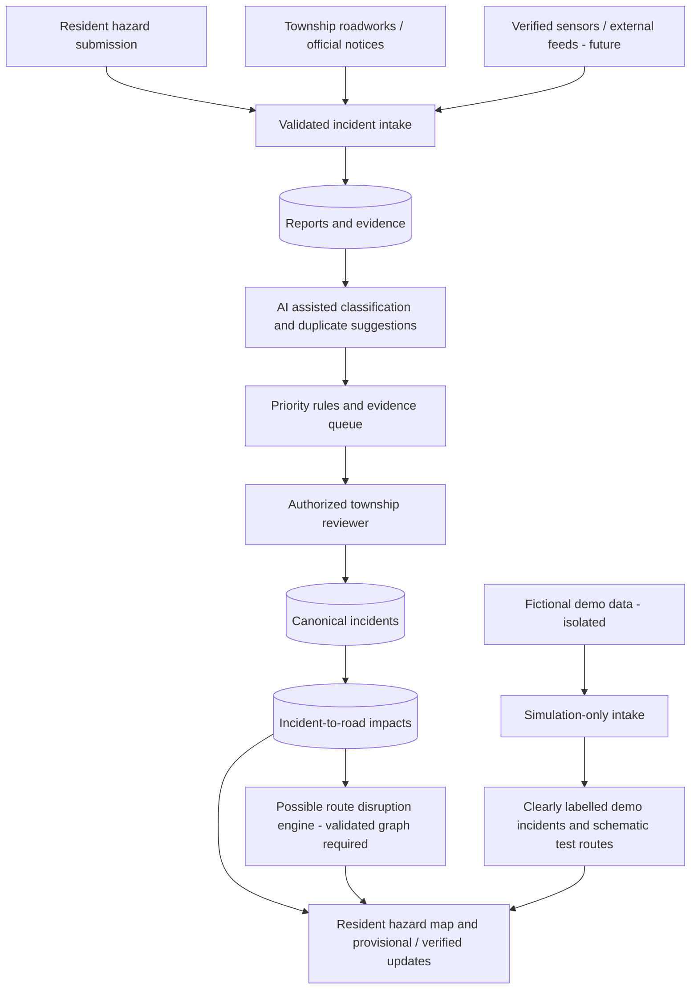

# Architecture — current v1 and proposed multi-hazard v2

> The v2 design below is a **proposal for review**. It does not describe currently deployed capabilities. The map is OSM geographic research, and the flood engine/network use fictional schematic XY coordinates.

## Current implemented architecture

- Frontend: Next.js + React + TypeScript + Tailwind resident and management pages.
- Maps: Leaflet geographic OSM reference workspace (source-tag and node research), plus a **separate** fictional schematic graph map.
- Persistence: Prisma + SQLite models for `TownshipZone`, `GraphNode`, `RoadSegment`, `RoadStatusEvent`, `ScenarioRun`, `FloodReport`, `AuditEntry`, `DataSource`.
- APIs: read-only network/zone APIs, fictional scenario state, demo report and operator-review APIs.
- Controls: `DEMO_OPERATOR_KEY` only in local development, not production authentication.
- No validated route recommendations, public photo hosting, real incident source integration, AI classification or production safety alerts.

## Proposed logical data flow

The diagram describes *future responsibilities*. Human review or a trusted and explicitly designated authoritative feed must establish confirmed closures. A machine-generated confidence score is not proof that a road is passable or blocked.

## Component responsibilities

| Component / boundary | Responsibility | Constraints |
| --- | --- | --- |
| **Incident intake** | Normalise category, location, timestamp, reporter/source, description and optional evidence | Reject malformed and oversized payloads; throttle abuse; never trust client-submitted verification statuses |
| **Evidence service** | Store photos privately, scan/check format, strip EXIF, moderate content and generate public-safe derivatives | Public photos require explicit moderation/consent; do not expose people's precise identities by default |
| **Incident service** | Link one or more reports to one incident, record status and history | Reports stay immutable evidence where appropriate; merge/split must be auditable |
| **AI analysis adapter** | Suggest category, text/image similarity, report clustering, attention level and explanation | Mark generated results `ai_suggested`; version model; allow fallback/disable; evaluate false positives |
| **Decision/policy engine** | Separate deterministic rules for review priority, provisional notices and expiry | Never automatically assert official closure based on crowd reports alone |
| **Management review** | Approve, reject, request clarification, link roads, record authority and timestamps | Requires proper authenticated operator roles before nonlocal deployment |
| **Map/UI** | Show category-filtered hazard pins, details, photos, sources, review state and stale markers | Distinguish user reports from verified operator messages and synthetic demos |
| **Road graph/impact** | Represent affected segments, direction, access, topology and closure state | Current OSM imports are geographic context only; validate before real routing |
| **Notification engine** | Opt-in alerts by vicinity or saved zone, with provenance and expiry | Avoid default storage of exact home addresses or continuous location |
| **Flood module** | Rainfall, drainage, retention, tide and flood-specific risk/evidence | Keep flood-specific factors in a module; don't impose them on pothole or construction incidents |

## API boundaries (proposed, not implemented)

- `POST /api/v2/reports`: create unverified report, hazard category and optional location.
- `POST /api/v2/evidence`: upload using safe storage rules or a signed-upload flow.
- `GET /api/v2/incidents`: bounded/filterable public view with appropriate privacy controls.
- `GET /api/v2/incidents/:id`: evidence, status history and allowed sources.
- `POST /api/v2/incidents/:id/review`: role-checked operator decision; record audit event.
- `POST /api/v2/ai/analyse`: server-internal, rate-limited triage, not a public privileged status changer.
- `GET /api/v2/route-impact`: initially synthetic-only; real routing remains gated on validation.

Proposed endpoints should be versioned or namespaced away from existing working demo APIs. UI can migrate gradually.

## Migration without damaging the current prototype

1. Keep `FloodReport`, schematic `RoadSegment`, `ScenarioRun` and existing tests intact in the first release.
2. Introduce additive hazard-specific tables and service functions, plus a source-mode discriminator.
3. Seed demo-only incident records with explicit `simulation` provenance; no automatic import from OSM tag metadata as reported hazards.
4. Route new map pins through the incident service, never through scenario road-status fields.
5. Later migrate selected old demo reports if required, with explicit conversion and tests. Avoid destructive table renames.
6. Production data access requires a real identity/access system, approved sources and privacy/security controls.

## Geographic separation and routing limits

An OpenStreetMap way and node relationship is not necessarily a drivable or legally permitted turn. A candidate route engine must understand verified connectivity, one-way direction, access restrictions, barriers, road levels and turn restrictions, and handle incomplete/expired incident evidence. No routing results derived from the current research map should be presented as safe alternatives for actual journeys. The first route-impact demo should use a **fictional, deterministic graph**.
